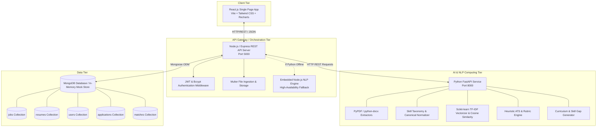
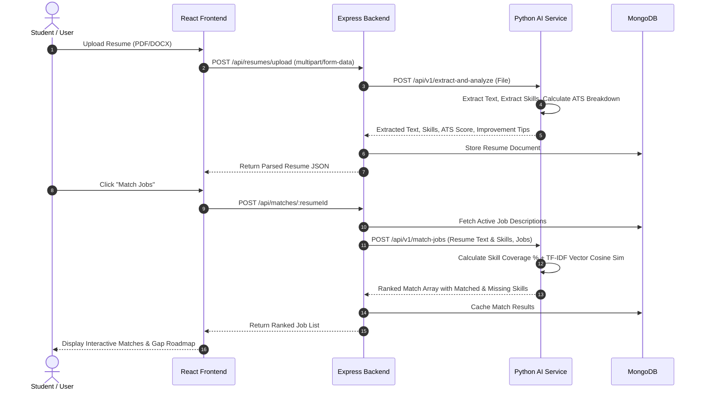

# System Architecture & Technical Design

## 1. High-Level System Architecture

The AI-Powered Resume Analyzer and Job Matcher utilizes a microservices-inspired decoupled architecture comprising four core tiers:

---

## 2. Component Breakdown

### 2.1 React Frontend (Client Layer)
- **Role:** Delivers a responsive, reactive user experience.
- **Key Modules:**
  - `Navbar` & `Sidebar`: Collapsible application navigation with active route highlights.
  - `ResumeUploader`: Drag-and-drop file ingestion supporting `.pdf`, `.docx`, `.txt` with real-time extraction progress.
  - `ScoreGauge` & `RadarChart`: Visual display of ATS metric scores (Completeness, Formatting, Keywords, Experience).
  - `JobMatcher`: Search, role filter, match score slider, and detailed side-by-side skill comparison.
  - `SkillGapView`: Interactive visual roadmap with progression milestones and vetted learning links.
  - `ResumeBuilder`: Template-driven resume form with live preview and PDF generation.
  - `ApplicationTracker`: Kanban board tracking pipeline (`Saved` $\rightarrow$ `Applied` $\rightarrow$ `Interview` $\rightarrow$ `Offer` / `Rejected`).
  - `MockInterview`: Chatbot-style role interview simulator evaluating user technical answers.
  - `ResumeComparator`: Visual side-by-side comparison of two resume versions.

### 2.2 Node.js & Express API Gateway
- **Role:** Handles client requests, user sessions, security authorization, and coordinates with MongoDB and the Python AI service.
- **Resilience Strategy:** Contains an embedded fallback NLP engine. If the Python AI service is unreachable or starting up, Express processes resumes directly using internal regex and token-distance algorithms, guaranteeing 100% service uptime during live presentations.

### 2.3 Python FastAPI AI Service
- **Role:** High-speed computation engine for text mining and NLP.
- **Extractors:** Uses `pypdf` for PDF stream parsing and `python-docx` for XML document decomposition.
- **NLP Normalization:** Normalizes over 500 tech skills (e.g., handles casing, punctuation, abbreviations, version suffixes).
- **Matching Algorithm:** Blends deterministic set-theoretic skill coverage with statistical TF-IDF cosine similarity.

---

## 3. Data Flow Diagram (DFD - Level 1)

---

## 4. Mathematical Formulation of the Matching Engine

The algorithm combines deterministic qualification metrics with semantic relevance:

### 1. Explicit Skill Coverage Score ($S_{cov}$):
$$S_{cov} = \frac{|\mathcal{S}_{resume} \cap \mathcal{S}_{job\_req}|}{|\mathcal{S}_{job\_req}|} \times 100$$
Where $\mathcal{S}_{resume}$ is the set of normalized skills in the resume, and $\mathcal{S}_{job\_req}$ is the set of required skills specified by the employer.

### 2. Semantic Similarity Score ($S_{sem}$):
Using Term Frequency-Inverse Document Frequency (TF-IDF):
$$\vec{v}_{resume} = \text{TF-IDF}(T_{resume}), \quad \vec{v}_{job} = \text{TF-IDF}(T_{job})$$
$$\text{Cosine Similarity} = \cos(\theta) = \frac{\vec{v}_{resume} \cdot \vec{v}_{job}}{\|\vec{v}_{resume}\|_2 \|\vec{v}_{job}\|_2}$$
$$S_{sem} = \text{Cosine Similarity} \times 100$$

### 3. Composite Final Match Score ($M_{final}$):
$$M_{final} = \text{round}\left(w_1 \cdot S_{cov} + w_2 \cdot S_{sem}\right)$$
By default, $w_1 = 0.70$ and $w_2 = 0.30$.
If a job has no specific skills tagged, $w_2$ defaults to 1.0.
This dual-score methodology prevents "black box" obscurity: students and recruiters can clearly see the exact percentage of required skills matched alongside general contextual fit.
