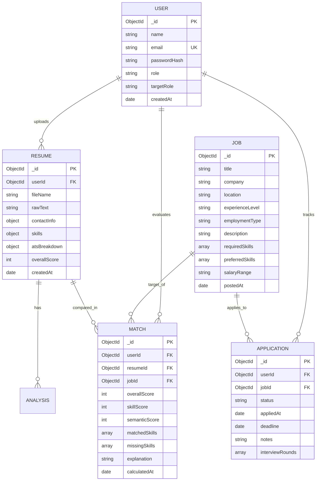

# Database Design & Schema Specification

## 1. Entity Relationship (ER) Conceptual Model

---

## 2. Detailed MongoDB Collection Schemas

### 2.1 `users` Collection
| Field | Type | Required | Description |
|---|---|---|---|
| `_id` | ObjectId | Yes | Unique Primary Identifier |
| `name` | String | Yes | Full Name of the User |
| `email` | String | Yes | Unique Email Address (Indexed) |
| `passwordHash` | String | Yes | Salted Bcrypt Hash (cost factor 10) |
| `role` | String | Yes | Enum: `'user'`, `'admin'` (default: `'user'`) |
| `targetRole` | String | No | Target Job Profile (e.g., 'Backend Engineer') |
| `createdAt` | Date | Yes | Auto Timestamp |

### 2.2 `resumes` Collection
| Field | Type | Description |
|---|---|---|
| `_id` | ObjectId | Primary Key |
| `userId` | ObjectId | Reference to `users._id` |
| `fileName` | String | Original uploaded file name |
| `fileSize` | Number | Size in bytes |
| `rawText` | String | Full extracted plain text |
| `contact` | Object | `{ name, email, phone, links: [] }` |
| `skills` | Object | `{ technical: [], soft: [], tools: [] }` |
| `sections` | Object | Boolean map: `{ education, experience, skills, projects, summary }` |
| `atsScore` | Object | `{ overall, breakdown: { completeness, skills, verbs, formatting }, tips: [] }` |
| `createdAt` | Date | Timestamp |

### 2.3 `jobs` Collection
| Field | Type | Description |
|---|---|---|
| `_id` | ObjectId | Primary Key |
| `title` | String | Job Title |
| `company` | String | Company Name |
| `location` | String | Location or Remote Status |
| `experienceLevel` | String | e.g. 'Entry-Level', 'Junior', 'Mid-Level' |
| `employmentType` | String | e.g. 'Full-time', 'Internship', 'Contract' |
| `description` | String | Comprehensive Job Description |
| `requiredSkills` | Array<String> | Normalized mandatory technical skills |
| `preferredSkills`| Array<String> | Bonus/Good-to-have skills |
| `salary` | String | Compensation range |
| `postedAt` | Date | Date added |

### 2.4 `matches` Collection
| Field | Type | Description |
|---|---|---|
| `_id` | ObjectId | Match record ID |
| `userId` | ObjectId | Reference to User |
| `resumeId` | ObjectId | Reference to Resume |
| `jobId` | ObjectId | Reference to Job |
| `overallScore` | Number | Combined weighted score (0-100) |
| `skillScore` | Number | Deterministic skill coverage percentage |
| `semanticScore` | Number | Cosine vector similarity percentage |
| `matchedSkills` | Array<String>| Intersected skills |
| `missingSkills` | Array<String>| Skill gap list |
| `explanation` | String | Explainable decision rationale |

### 2.5 `applications` Collection
| Field | Type | Description |
|---|---|---|
| `_id` | ObjectId | Application ID |
| `userId` | ObjectId | Reference to User |
| `jobId` | ObjectId | Reference to Job |
| `status` | String | Enum: `'Saved'`, `'Applied'`, `'Interview'`, `'Offered'`, `'Rejected'` |
| `appliedAt` | Date | Date applied |
| `notes` | String | User personal interview notes |
| `updatedAt` | Date | Last status modification date |
